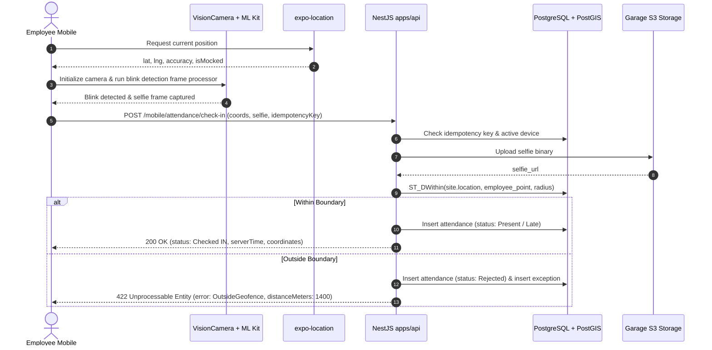
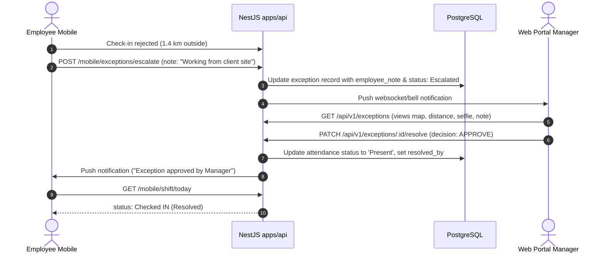
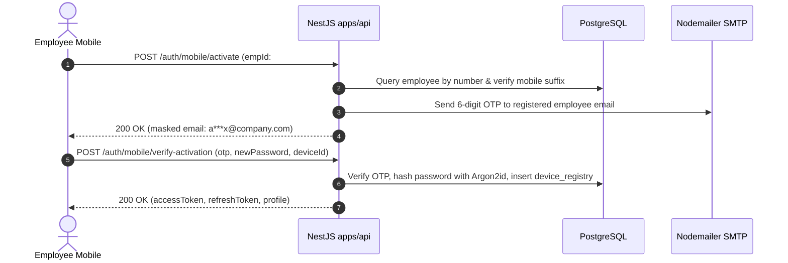

# Bridge Contract & Specification: Digital Attendance Mobile & Backend Bridge

## ASSUMPTIONS I'M MAKING:
1. **Single Backend & Database**: There will be NO duplicate backend. All mobile interactions speak directly to `apps/api` (NestJS) and connect to the existing PostgreSQL/PostGIS database.
2. **Free and Open-Source Only**:
   - Camera & Liveness: `react-native-vision-camera` with `@react-native-ml-kit/face-detection` frame processor. No commercial/paid liveness SDKs (AWS Rekognition, FaceTec, Innovatrics).
   - Local DB & Storage: `expo-sqlite` for offline attendance queue and `expo-secure-store` for token/key storage.
   - SMS Free Substitution: SMS OTP is avoided due to Indian DLT regulations and paid gateway costs. The activation code ("Send activation code") supports an **HR-issued physical one-time voucher code** (or email dispatch over SMTP as an alternative adapter).
   - Password reset ("HR will email you a reset link") sends an email via self-hosted SMTP (Nodemailer/Mailpit) to the employee's corporate email registered by HR.
   - S3 Storage & DPDP Compliance: Self-hosted Garage / SeaweedFS S3-compatible storage adapter for selfie evidence storage, configured with an automatic 90-day retention/purge lifecycle rule under India's DPDP Act.
   - Mobile Build & Platform: **Android-first local builds** (`expo prebuild` + Gradle). iOS is configured for simulator-only verification to avoid paid Apple Developer Program fees.
3. **Authentication Mechanism**:
   - Web uses httpOnly cookies. Mobile client uses short-lived JWT access tokens (15m) and rotating refresh tokens (30d) tied to a registered device ID in a new `device_registry` table.
4. **Idempotency & Clock Authority**:
   - The server clock and PostGIS distance calculations (`ST_DWithin`) are the ONLY authoritative verdict. The client time and client GPS distance calculations are advisory only. Check-in/out requests carry a UUIDv4 idempotency key generated by the client.
5. **Site Geofence Radius**:
   - The default site geofence radius is **800 meters**, configurable and overridable per site in the database/web admin by the manager.
6. **Brand Tokens & Palette**:
   - Mobile app adopts the amber and navy visual theme shown in the reference screens (Option A Light / Option B Navy, primary action amber `#F59E0B`/`#EAA326`, navy `#0B192C`/`#1E293B`), while web retains its purple theme `#7C3AED`.

---

## 1. Requirements Traceability

Every requirement maps directly to authoritative screens in `./reference/mobile/` and corresponding bridge screens in `./reference/web/`:

| Requirement ID | Description | Mobile Screen Reference | Web Screen Reference | API Contract / Bridge Impact |
|---|---|---|---|---|
| `REQ-MOB-AUTH-01` | Sign In with Employee ID (e.g. `#EMP-2062`) and Password | `E1-Employee-Login.png` | `AM 01 · Sign in — Web.png` | `POST /api/v1/auth/mobile/login` |
| `REQ-MOB-AUTH-02` | Account Activation for HR-registered employees using last 5 digits of mobile | `E3-Employee-Activate-Account.png` | `employee-directory.png` | `POST /api/v1/auth/mobile/activate` & `POST /api/v1/auth/mobile/verify-activation` |
| `REQ-MOB-AUTH-03` | Forgot password triggers reset link via HR/SMTP | `E5-Employee-Forgot-Password.png`, `E41-Employee-Reset-Password-Confirm.png` | — | `POST /api/v1/auth/mobile/forgot-password` |
| `REQ-MOB-PERM-01` | OS Permissions prompt: Location (Foreground only) & Camera; location privacy guarantee | `E7-Employee-Permissions.png` | — | Expo permission hooks (no background location requested) |
| `REQ-MOB-HOME-01` | Shift Dashboard before check-in: Greeting, shift status `Check-in Pending`, times, action button | `E8-Employee-Dashboard-Not-Checked-In.png`, `HD · Employee Home — check in.png` | `AM 02 · Dashboard — Team today.png` | `GET /api/v1/mobile/shift/today` |
| `REQ-MOB-LOC-01` | Geolocation pre-validation displaying assigned site (e.g. BLR-1, Bengaluru) | `E9-Employee-CheckIn-Location-Check.png`, `E15-Employee-CheckOut-Location-Check.png` | `locations-admin-view.png`, `add-location-page.png` | `GET /api/v1/mobile/sites/assigned` |
| `REQ-MOB-BIO-01` | Front-facing camera preview with oval and inner circle guide | `E10-Employee-CheckIn-Biometric-Capture.png`, `E16-Employee-CheckOut-Biometric-Capture.png` | `AM 07 · Exception review.png` | Frame processor captures selfie upon alignment |
| `REQ-MOB-LIVE-01` | Offline on-device ML Kit blink detection; "Blink Detected!" confirmation | `E11-Employee-CheckIn-Liveness-Blink.png`, `E17-Employee-CheckOut-Liveness-Blink.png` | `AM 07 · Exception review.png` | Face detection frame processor computing `leftEyeOpenProbability` and `rightEyeOpenProbability` |
| `REQ-MOB-CHK-01` | Check-in submission: Site, GPS coords, accuracy, mock-flag, selfie, idempotency key | `E12-Employee-CheckIn-Success.png` | `AM 06 · Exceptions — Queue.png`, `AM 07 · Exception review.png` | `POST /api/v1/mobile/attendance/check-in` |
| `REQ-MOB-HOME-02` | Shift Dashboard checked in: status `Checked IN`, check-in time, running total hours, CHECK OUT | `E13-Employee-Dashboard-Checked-In.png` | `AM 02 · Dashboard — Team today.png` | Client running hours counter based on server check-in timestamp |
| `REQ-MOB-OUT-01` | Confirm Check-Out dialog displaying total work hours | `E14-Employee-CheckOut-Confirm.png` | — | Confirmation modal preceding biometric validation |
| `REQ-MOB-OUT-02` | Check-out submission & Success: total hours, timestamp, site | `E18-Employee-CheckOut-Success.png` | `AM 02 · Dashboard — Team today.png` | `POST /api/v1/mobile/attendance/check-out` |
| `REQ-MOB-HOME-03` | Shift Dashboard checked out: "Goodbye", status `Checked Out`, disabled check-in button | `E19-Employee-Dashboard-Checked-Out.png` | `AM 02 · Dashboard — Team today.png` | Shift state lock until site cutoff |
| `REQ-MOB-ERR-01` | Geofence mismatch warning: "You're outside the work area", distance, Retry & Send to Supervisor | `E20-Employee-Error-Outside-Work-Area.png`, `E21-Employee-Error-Outside-Work-Area-Alt.png` | `AM 07 · Exception review.png` | `POST /api/v1/mobile/exceptions/escalate` |
| `REQ-MOB-ERR-02` | Supervisor message confirmation & Dashboard in `Pending Review` status | `E22-Employee-Message-Sent-To-Supervisor.png`, `E23-Employee-Dashboard-Pending-Review.png` | `AM 06 · Exceptions — Queue.png` | Dashboard state machine handles `Pending Review` |
| `REQ-MOB-ERR-03` | Biometric error & retry dialogs | `E24-Employee-Error-Selfie-Not-Verified.png`, `E25-Employee-Biometric-Retry.png`, `E39-Employee-Error-Camera-Unavailable.png` | `AM 07 · Exception review.png` | Retry triggers new frame capture |
| `REQ-MOB-OFF-01` | Offline state handling & dashboard context notice | `E36-Employee-No-Internet-Connection.png`, `E37-Employee-Dashboard-Offline-Context.png` | — | Local `expo-sqlite` queue; records synced when network returns |
| `REQ-MOB-PROF-01` | Employee profile & drawer navigation | `E34-Employee-Profile.png`, `menu.png` | `AM 05 · Employee detail.png` | `GET /api/v1/mobile/profile` |

---

## 2. Design Inconsistencies & Resolutions

1. **Check-in Time Discrepancy**: `E12-Employee-CheckIn-Success.png` shows `09:15 AM`, whereas `E13-Employee-Dashboard-Checked-In.png` shows `09:42 AM` on the same date (24 Aug 2026).
   * *Resolution*: In production, the dashboard displays the exact server-persisted timestamp returned by the check-in submission response.
2. **Check-out Time Discrepancy**: `E18-Employee-CheckOut-Success.png` shows `05:12 PM`, whereas `E19-Employee-Dashboard-Checked-Out.png` shows `05:30 PM`.
   * *Resolution*: Server check-out timestamp is the single authoritative value displayed across all screens.
3. **Total Hours Calculation**: Screen timestamps and running hours do not mathematically correspond (e.g., 09:42 AM to 04:50 PM is 7h 8m, but screen shows 8h 12m).
   * *Resolution*: Total hours is strictly computed on the server: `duration = checkOutTime - checkInTime - approvedBreakTime`. The mobile app never computes billable work hours independently.
4. **Permissions Screen Contrast**: `E7-Employee-Permissions.png` exhibits very low contrast on title and subtext.
   * *Resolution*: We enforce WCAG AA compliance (4.5:1 ratio) utilizing Navy `#0B192C` on White/Off-white `#F8FAFC`.
5. **Employee ID Formats**: Mobile inputs `#EMP-2062`; Web displays `TRIL-4821` and `EMP-4821`.
   * *Resolution*: The canonical database identifier is `EMP-XXXX` (uppercase alphanumeric). The mobile input sanitizer trims whitespace, strips leading `#`, and normalizes to standard uppercase `EMP-XXXX`.
6. **Next Check-In Message vs. Late Cutoff**: `E19` shows "Check in after 9AM tomorrow", while the web backend enforces a `09:30 AM` late cutoff.
   * *Resolution*: Site operational hours are configurable per site: `shiftStartTime` (09:00 AM) and `lateCutoffTime` (09:30 AM Asia/Kolkata). Check-ins between 09:00 and 09:30 are `Present`; check-ins after 09:30 are flagged as `Late`. Check-in button unlocks at `shiftStartTime`.
7. **"New User" vs. "HR has registered you"**:
   * *Resolution*: Self-registration is strictly prohibited. The "New User" button navigates to the Account Activation screen where an HR-pre-provisioned employee confirms their mobile last 5 digits and sets their initial password.
8. **Biometric Face Guide Inconsistency**: `E10` shows a stock face model inside the guide, while `E11` shows empty guide circles.
   * *Resolution*: Camera view is a live video feed with an SVG overlay of the target oval and pupil/nose alignment guide.
9. **Color Palette Disparity**: Web uses purple `#7C3AED`, while Mobile uses Amber `#F59E0B` and Navy `#0B192C`.
   * *Resolution*: Mobile styling uses the Amber/Navy token set (`OPTION A` Light and `OPTION B` Navy) via an isolated theme configuration.

---

## 3. The Bridge Specification

### 3.1 Identity & Mobile Authentication
- **Canonical ID**: In `employees` table, `employee_number` stores `EMP-2062`.
- **Device Registry Table** (`device_registry`):
  - `id` (UUID PK)
  - `employee_id` (UUID FK -> `employees.id`)
  - `device_id` (string, hardware/installation UUID)
  - `device_model` (string)
  - `os_version` (string)
  - `app_version` (string)
  - `fcm_token` (string, nullable)
  - `is_active` (boolean, default true)
  - `last_active_at` (timestamptz)
- **Token Model**:
  - `POST /api/v1/auth/mobile/login`: accepts `{ employeeId, password, deviceId, deviceModel, osVersion, appVersion }`.
  - Returns `{ accessToken, refreshToken, expiresIn, employee: { id, name, employeeNumber, site } }`.
  - Access Token: JWT (15 mins lifespan).
  - Refresh Token: cryptographically secure opaque token hashed in database (30 days lifespan, single-use rotating).

### 3.2 Account Provisioning & Activation Flow
- HR registers employee in web portal (`POST /api/v1/workforce`). Record created with status `INVITED` or `ACTIVE` (password null or temporary).
- Employee opens mobile app, taps "New User" (`E1`), navigates to `E3`.
- Inputs `employeeId` ("#EMP-2062") and registered mobile last 5 digits ("42062").
- Mobile app calls `POST /api/v1/auth/mobile/activate`.
- Backend verifies matching `employee_number` and mobile phone suffix.
- Free Tier Adapter generates a 6-digit OTP stored in Redis (5 min TTL) and sends via SMTP to the employee's registered email (with an SMS adapter interface stubbed).
- Employee enters OTP and sets password via `POST /api/v1/auth/mobile/verify-activation`, which binds `deviceId` in `device_registry`.

### 3.3 Site & Geofence Distribution
- Mobile app invokes `GET /api/v1/mobile/sites/assigned` upon sign-in and sync.
- Payload includes:
  ```json
  {
    "siteId": "uuid",
    "siteCode": "BLR-1",
    "name": "Bengaluru Headquarters",
    "city": "Bengaluru",
    "latitude": 12.9716,
    "longitude": 77.5946,
    "radiusMeters": 500,
    "shiftStartTime": "09:00",
    "lateCutoffTime": "09:30",
    "timezone": "Asia/Kolkata"
  }
  ```
- *Rule*: The client uses this data solely for local UI pre-checking and distance hints. The server computes the authoritative distance using PostGIS:
  `ST_DWithin(site.geog, ST_SetSRID(ST_MakePoint(longitude, latitude), 4326)::geography, site.radius_meters)`.

### 3.4 Check-In / Check-Out Submission & Outcomes
- Endpoint: `POST /api/v1/mobile/attendance/check-in` (multipart/form-data)
  - `siteId`: UUID
  - `latitude`: number
  - `longitude`: number
  - `accuracyMeters`: number
  - `isMockLocation`: boolean
  - `clientCapturedAt`: ISO8601 string
  - `deviceId`: string
  - `idempotencyKey`: UUIDv4
  - `livenessPassed`: boolean
  - `blinkDetected`: boolean
  - `selfie`: File (JPEG image binary)
- Authoritative Backend Verification:
  1. Check `idempotencyKey` in Redis/DB; return existing record if already processed.
  2. Evaluate Mock Location: if `isMockLocation === true` or `accuracyMeters > 50`, flag for review.
  3. Evaluate Geofence: if `ST_DWithin` is false, calculate distance `d = ST_Distance(site.geog, employee.geog)`. If $d > \text{radius}$, status becomes `Rejected` (Outside Geofence) or creates an Exception.
  4. Evaluate Late Cutoff: If server time in site timezone > `lateCutoffTime`, mark as `Late`. Otherwise `Present`.
  5. Store selfie in self-hosted Garage/SeaweedFS storage, record URL.
  6. Insert into `attendance` and, if breached, into `exceptions`.

### 3.5 Unified Status State Machine
Shared in `packages/shared/src/types/index.ts`:

```
Mobile Shift Status:
[ Check-in Pending ] ──(Check-in OK)──→ [ Checked IN ] ──(Check-out OK)──→ [ Checked Out ]
        │                                     │
  (Outside Geofence /                    (Outside /
    Liveness Error)                      Missing Checkout)
        │                                     │
        ▼                                     ▼
[ Pending Review ]                    [ Pending Review ]

Web Attendance Status:
- Present: Checked in within boundary before 09:30
- Late: Checked in within boundary after 09:30
- Absent: No check-in recorded by shift end
- Rejected: Check-in outside geofence without manager override
- Flagged: Liveness failed, mock location detected, or GPS accuracy low
```

### 3.6 Sequence Diagrams

#### A. Check-In End-to-End Flow


#### B. Outside-Boundary Rejection & Manager Resolution Flow


#### C. Employee Activation Flow


---

## 4. Mobile Technical Architecture & Boundaries

### 4.1 Commands
```bash
# Mobile application (apps/mobile)
Dev: pnpm --filter @triattendance/mobile start
Build Android (Local): pnpm --filter @triattendance/mobile android
Run Maestro E2E: maestro test apps/mobile/e2e/checkin-flow.yaml
Test (Unit): pnpm --filter @triattendance/mobile test
Lint: pnpm --filter @triattendance/mobile lint

# API and Shared
Dev API: pnpm --filter @triattendance/api start:dev
Build API: pnpm --filter @triattendance/api build
Test API: pnpm --filter @triattendance/api test
```

### 4.2 Project Structure
```
apps/mobile/
├── assets/                  # Icons, splash screen, offline illustrations
├── src/
│   ├── app/                 # Expo Router file-based screens
│   │   ├── (auth)/          # sign-in, activate, forgot-password
│   │   ├── (tabs)/          # home/shift, exceptions, profile
│   │   ├── checkin/         # location-check, camera-biometric, success
│   │   └── checkout/        # confirm, location-check, biometric, success
│   ├── components/          # UI primitives (AmberButton, CameraGuide, RadarPulse)
│   ├── hooks/               # useLocation, useBlinkDetection, useShiftStatus
│   ├── services/            # offline-queue, api-client, secure-storage
│   ├── theme/               # Colors (amber/navy), typography, spacing
│   └── lib/                 # SQLite setup, error handlers
└── e2e/                     # Maestro automation test flows
```

### 4.3 Boundaries
- **Always do**:
  - Request FOREGROUND permissions only (`expo-location.requestForegroundPermissionsAsync`).
  - Compute liveness and blink verification completely on-device without cloud APIs.
  - Store tokens in `expo-secure-store` and cached requests in `expo-sqlite`.
  - Validate all payloads with shared Zod schemas from `packages/shared`.
- **Ask first**:
  - Modifying existing web API routes or existing Drizzle schema files in `apps/api/src/database/schema/`.
  - Adding native Android/iOS third-party packages requiring native module linking.
- **Never do**:
  - Never request or declare `ACCESS_BACKGROUND_LOCATION` permission.
  - Never trust client device time for attendance recording.
  - Never integrate paid verification or SMS gateway services.

---

## 5. Success Criteria

1. **Forensic Traceability**: Every screen from `E1` through `E41` maps to a distinct route or modal state in `apps/mobile/src/app`.
2. **Foreground-Only Privacy**: Android manifest inspection verifies zero declarations of `ACCESS_BACKGROUND_LOCATION`. No GPS tracking occurs when the app is backgrounded or between shifts.
3. **Offline ML Kit Blink Liveness**: Biometric frame processor detects eye blink transitions ($P(\text{open}) > 0.75 \to P(\text{open}) < 0.2 \to P(\text{open}) > 0.75$) within 5 seconds without network connectivity.
4. **Authoritative Distance Check**: Submissions from coordinates outside the site boundary are rejected by PostGIS with a calculated distance matching the UI ("1.4 km outside").
5. **Unified Database Integrity**: Mobile check-ins appear instantly in the Account Manager web portal dashboard (`AM 02`) and Exceptions queue (`AM 06`).
6. **Zero Paid Services**: The entire flow operates on free, open-source, and self-hosted tools (React Native, Expo prebuild, ML Kit, NestJS, PostGIS, Valkey, Garage S3, Nodemailer).

---

## 6. Resolved Decisions (Formerly Open Questions)

1. **HR-Issued Physical Voucher for Activation**: Confirmed. Account activation supports an HR-issued physical one-time activation voucher code as the primary free mechanism (with email OTP over SMTP as an alternative adapter).
2. **Platform Strategy**: Confirmed Android-first with local Gradle builds; iOS configured for simulator-only verification to avoid paid Apple Developer fees.
3. **Selfie Data Retention & DPDP Act**: Confirmed. Selfies stored in Garage/SeaweedFS S3 have a strict 90-day retention policy after which evidence is purged or anonymized.
4. **Site Geofence Radius**: Confirmed. Default site geofence radius is 800 meters, overridable per site and controlled by the account manager in the web portal.
---

## SKILL.md Verification Checklist
- [x] Scope check evaluated and capability map documented in root `CAPABILITY-MAP-MOBILE.md`.
- [x] Assumptions surfaced at the top of the spec.
- [x] All 6 core spec areas covered (Objective, Commands, Project Structure, Code Style, Testing Strategy, Boundaries).
- [x] Full executable commands specified with flags.
- [x] Real code snippet and architectural style defined.
- [x] Three-tier boundaries explicitly documented.
- [x] Traceability mapped to reference mobile and web screens.
- [x] Success criteria reframed as specific, testable conditions.
- [x] Stopped turn before writing any plan or implementation code.


